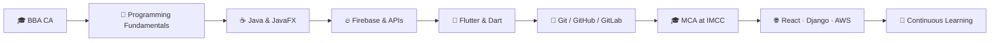

<div align="center">


<a href="https://git.io/typing-svg">
  
</a>

<br/>


</div>

---

## 👩‍💻 About Me

I'm a **Master of Computer Applications (MCA) student at MES's IMCC, Pune**, and a **BBA(CA) graduate** from **Sinhgad College of Arts and Commerce, Warje, Pune**. I'm passionate about building **mobile and web applications** that are clean, functional, and easy to use.

I learn best by building. My projects include a desktop shopping application in **Java/JavaFX** and **Nivara**, a cross-platform **Flutter** real estate app. I'm now expanding into **web and cloud technologies** like React, Django, and AWS.

```yaml
name: Juie Khadtare
role: Aspiring Software Developer
education:
  - MCA - MES's IMCC, Pune (Pursuing)
  - BBA(CA) - Sinhgad College of Arts and Commerce, Pune
location: Pune, Maharashtra, India
focus: [Flutter, Java, Firebase, REST APIs]
currently_exploring: [React, Django, AWS]
open_to: Collaboration on interesting projects
```

---

## 🛠️ Tech Stack

### 💻 Languages


### 📱 Mobile & Desktop Development


### ☁️ Backend, Database & APIs


### 🔧 Tools & Platforms


### 🌱 Currently Exploring


---

## 🚀 Featured Projects

<table>
  <tr>
    <td width="50%" valign="top">

### 🏠 Nivara - Real Estate Mobile App

A cross-platform mobile application for exploring and managing real estate properties through a clean, convenient interface.

**✨ Highlights**
- Cross-platform development with Flutter & Dart
- Firebase backend integration
- Local data storage using SQFlite
- API integration and testing with Postman
- Clean, user-friendly mobile experience

**🧰 Tech Stack**


   </td>
    <td width="50%" valign="top">

### 🛍️ Customized Shopping App

A desktop shopping application focused on a smooth, user-friendly shopping experience with reliable data management.

**✨ Highlights**
- Intuitive desktop UI built with JavaFX
- Firebase integration for data storage
- API integration and testing with Postman
- Application logic and data management in Java

**🧰 Tech Stack**


   </td>
  </tr>
</table>

---

## 📊 GitHub Stats

<div align="center">


</div>

---

## 🎯 Current Goals

- 🎓 Complete my **MCA** with strong practical and project experience
- 🌐 Build web applications with **React** and **Django**
- ☁️ Learn **AWS** and cloud deployment fundamentals
- 📱 Grow stronger in **Flutter** and mobile app architecture
- 🔌 Design, build, and consume **REST APIs** with confidence
- 🧩 Improve **problem-solving** and programming fundamentals
- 🤝 Collaborate on interesting open-source and team projects

---

## 🗺️ Development Journey



---

## 📫 Let's Connect

<div align="center">

[](https://www.linkedin.com/in/juie-khadtare)
[](mailto:khadtarejuie375@gmail.com)
[](https://github.com/khadtarejuie375-debug)

*I'm always happy to chat about tech, projects, or collaboration. Feel free to reach out!*

<br/>


⭐ *Thanks for visiting my profile!* ⭐

</div>
