  

 

I'm **Juie Khadtare**, an **MCA student at MES's IMCC, Pune** and a **BBA(CA) graduate** from **Sinhgad College of Arts and Commerce, Warje, Pune**.

I love building **web and mobile applications**, turning ideas into functional, user-friendly products, and learning something new with every project.

- 🎓 **MCA** (pursuing) at MES's IMCC, Pune
- 🎓 **BBA(CA)** graduate, Sinhgad College of Arts and Commerce, Warje
- 📍 Based in **Pune, Maharashtra, India**
- 📱 Building cross-platform apps with **Flutter & Dart**
- ☕ Desktop apps with **Java & JavaFX**
- 🔥 Backend with **Firebase**, local storage with **SQFlite**
- 🧪 API testing with **Postman**
- 🤖 Using AI-assisted tools like **GitHub Copilot**
- 🌱 Currently exploring **React, Django & AWS**
- 🤝 Open to collaborating on interesting projects

 

| 💻 Languages | 📱 Mobile & Desktop | ☁️ Backend, Database & APIs |
|:---:|:---:|:---:|
|  |   |   |

| 🔧 Tools & Platforms | 🌱 Currently Exploring |
|:---:|:---:|
|   |  |

 

<table>
<tr>
<td width="50%" valign="top">

### 🏠 Nivara
**Real Estate Mobile App**

A cross-platform mobile app for exploring and managing real estate properties through a clean, convenient interface.

**✨ Highlights**
- 📱 Cross-platform development with Flutter & Dart
- 🔥 Firebase backend integration
- 💾 Local data storage using SQFlite
- 🔌 API integration and testing with Postman
- 🎨 Clean, user-friendly mobile experience

</td>
<td width="50%" valign="top">

### 🛍️ Customized Shopping App
**Desktop Shopping Application**

A desktop shopping application built to give users a smooth, convenient shopping experience with reliable data management.

**✨ Highlights**
- 🖥️ Intuitive desktop UI built with JavaFX
- 🔥 Firebase integration for data storage
- 🔌 API integration and testing with Postman
- ⚙️ Application logic and data handling in Java

</td>
</tr>
</table>

 

 

- 🎓 Complete my **MCA** with strong practical and project experience
- 🌐 Build full web applications with **React** and **Django**
- ☁️ Learn **AWS** and cloud deployment fundamentals
- 📱 Grow stronger in **Flutter** and mobile app architecture
- 🔌 Design, build, and consume **REST APIs** with confidence
- 🧩 Sharpen my **problem-solving** and programming fundamentals
- 🚀 Build more real-world projects and share them here
- 🤝 Collaborate on interesting open-source and team projects

```mermaid
flowchart LR
    A([🎓 BBA CA]) --> B([📘 Programming<br/>Fundamentals])
    B --> C([☕ Java & JavaFX])
    C --> D([🔥 Firebase<br/>& APIs])
    D --> E([📱 Flutter<br/>& Dart])
    E --> F([🔧 Git · GitHub<br/>GitLab])
    F --> G([🎓 MCA<br/>at IMCC])
    G --> H([🌐 React · Django<br/>AWS])
    H --> I([🚀 Continuous<br/>Learning])

    style A fill:#f857a6,stroke:#fff,color:#fff
    style B fill:#e8559e,stroke:#fff,color:#fff
    style C fill:#c05bd0,stroke:#fff,color:#fff
    style D fill:#9a5be8,stroke:#fff,color:#fff
    style E fill:#7f5af0,stroke:#fff,color:#fff
    style F fill:#5a7ef0,stroke:#fff,color:#fff
    style G fill:#3a9be8,stroke:#fff,color:#fff
    style H fill:#2cb5e8,stroke:#fff,color:#fff
    style I fill:#00c9a7,stroke:#fff,color:#fff
```

 

 

*I'm always happy to talk tech, projects, or collaboration. Feel free to reach out!*

 

  

⭐ *Thanks for stopping by!* ⭐

